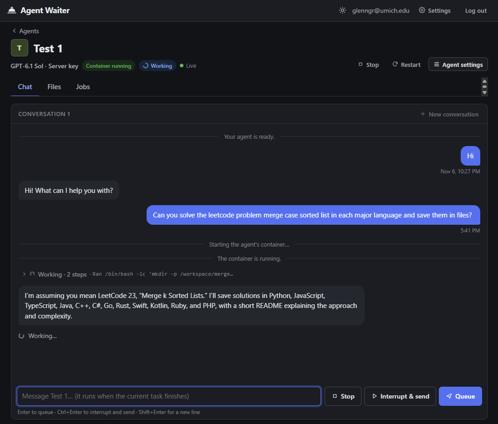
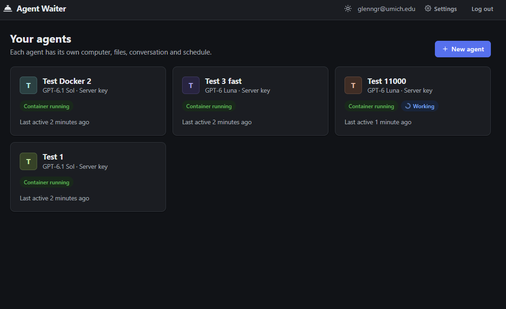
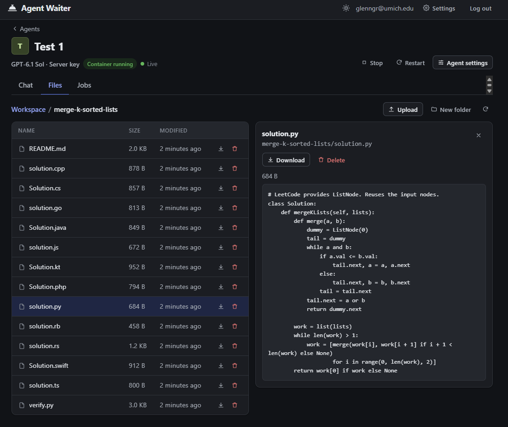

# agent-waiter

Self-hosted web platform for personal AI agents, written in Python. Anyone can sign up in the browser, create agents, chat with them, browse the files they produce, and give them scheduled jobs. Each agent runs in its own Docker container with [Codex app server](https://github.com/openai/codex) as the harness inside it, and every user brings their own model API key.

<p align="center">
  
</p>

<table>
  <tr>
    <td width="50%"></td>
    <td width="50%"></td>
  </tr>
  <tr>
    <td align="center"><sub>Each agent has its own container, files, conversation, and schedule</sub></td>
    <td align="center"><sub>Browse, preview, and download the files an agent writes</sub></td>
  </tr>
</table>

## Overview

The platform includes:

- A **backend** (FastAPI, one process) that:
  - Handles accounts, sessions, and per-user isolation on every route and file path
  - Starts, stops, and restarts one container per agent, and stops idle ones
  - Runs each chat turn through the Codex Python SDK and streams it to the browser over SSE
  - Stores users, agents, conversations, jobs, and usage in SQLite

- **Agents** that:
  - Run `codex app-server` inside their own container, with a private workspace
  - Can read and write files and run commands in that workspace
  - Keep their conversation and files when the container is deleted and recreated
  - Can schedule their own follow-up jobs through an MCP server the backend exposes

- A **model proxy** that:
  - Is the only place a real API key is ever used; no key enters a container
  - Routes each agent's model calls to its provider with the owner's key
  - Translates the Responses API to the Anthropic Messages API, so Claude models run under the same harness
  - Records token usage per user, agent, and model

- A **web client** (plain HTML/JS/CSS, no build step) with:
  - Chat with live streaming, a message queue, and interrupt/stop
  - A file browser for each agent's workspace (preview, upload, download)
  - A jobs tab for one-time, interval, and cron schedules, with run history
  - A settings page for API keys, usage, and the account

```
browser ──▶ backend (FastAPI) ──docker exec──▶ codex app-server (one container per agent)
             │  SQLite, SSE, scheduler               │
             │◀──── /model-proxy (holds the keys) ◀──┤
             │◀──── /mcp (schedule_job, list_jobs) ◀─┘
```

Chat turns are owned by the backend, so closing the browser mid-turn changes nothing: the turn keeps running and the page catches up when it reconnects. Messages sent while an agent is working wait in a queue and run in order.

More detail on the design is in [docs/designs/agent-platform.md](docs/designs/agent-platform.md).

## API Keys

There is no shared key by default. Each user adds their own under **Settings → API keys**:

| Provider | Models |
|---|---|
| OpenAI | GPT-6.1 Sol, GPT-6 Luna |
| Anthropic | Claude Opus 5.5, Sonnet 5.5, Haiku 5.5, Fable 5.1 |
| U-M GPT Toolkit | GPT-6.1 Sol, GPT-6 Luna |
| OpenAI-compatible | Any server that implements the Responses API, by URL |

- Keys are checked against the provider when they are added
- They are encrypted at rest and belong to one account
- Only the last four characters are ever sent back to the browser
- Agents call the model proxy with a per-agent token, so a key never reaches a container or the model

If you run the server, you can optionally put one key of your own in `.env` and list which accounts may use it (see [Setup](#setup)). Accounts that are not listed never touch it.

## Project Structure

```
.
├── den/                       # The backend package
│   ├── __main__.py            # Entry point (python -m den)
│   ├── app.py                 # FastAPI app, startup/shutdown, CSRF check
│   ├── auth.py                # Register, login, sessions, agent ownership check
│   ├── agents.py              # Create/rename/delete agents, container start/stop
│   ├── chat.py                # Send, stop, queue, history, live event stream (SSE)
│   ├── codex_bridge.py        # Runs one Codex turn and turns its events into platform events
│   ├── files.py               # Workspace browse/preview/upload/download
│   ├── jobs.py                # Job and run routes
│   ├── scheduler.py           # Schedule math and the scheduler loop
│   ├── mcp_server.py          # MCP endpoint agents use to schedule jobs
│   ├── model_proxy.py         # Sends each agent's model calls out with the right key
│   ├── providers.py           # Provider catalog, encrypted user keys, key checks
│   ├── anthropic_bridge.py    # Responses API <-> Anthropic Messages API translation
│   ├── account.py             # Settings routes: API keys, usage
│   ├── usage.py               # Token counting and cost estimates
│   ├── lifecycle.py           # Onboarding, idle reaper, agent deletion
│   ├── security.py            # Password hashing, tokens
│   ├── security_headers.py    # CSP and other browser security headers
│   ├── db.py                  # SQLite schema and helpers
│   ├── runtime/
│   │   ├── docker.py          # One container per agent
│   │   └── local.py           # No containers, for development and tests
│   └── static/                # Web client
├── container/
│   └── Dockerfile             # The agent image
├── scripts/
│   ├── check_secrets.py       # Secret scan for tracked files and git history
│   └── install-git-hooks.sh   # Installs the scan as a pre-commit hook
├── tests/
│   ├── test_*.py              # Unit and end-to-end tests
│   ├── fake_model.py          # Scripted stand-in for the OpenAI Responses API
│   └── fake_anthropic.py      # Strict fake of the Anthropic Messages API
├── docs/designs/              # Design doc
├── .env.example
├── requirements.txt
└── README.md
```

## Setup

Requires Linux or WSL2, Python 3.12, and Docker (on Windows, Docker Desktop with WSL integration turned on).

```bash
git clone https://github.com/glenngriggs/agent-waiter.git
cd agent-waiter

python3 -m venv .venv
.venv/bin/pip install -r requirements.txt
cp .env.example .env
```

Nothing in `.env` is required. To also use a key of your own without adding it in Settings, set it together with the accounts that may use it:

```bash
UMGPT_TOOLKIT_API_KEY=...
DEN_PLATFORM_KEY_USERS=you@example.com
```

`OPENAI_API_KEY` works the same way. Sign-up does not verify emails, so a listed email only counts for an account that already existed when the server started: sign up first, then restart. `.env` is git-ignored.

## Running

```bash
.venv/bin/python -m den
```

Then open http://localhost:8000, sign up, add an API key in Settings, and create an agent. The first agent builds the agent image, which takes a few minutes once. To build it ahead of time:

```bash
docker build -t den-agent:0.163.0-2 container/
```

Everything the platform stores lives under `DEN_DATA_DIR` (default `~/.local/share/den`). Delete that directory and any `den-agent-*` containers to start over.

### Without Docker

```bash
DEN_RUNTIME=local .venv/bin/python -m den
```

Agents then run directly on your machine with no isolation. This mode is for development only, and the page shows a banner while it is on.

### Without an API key

The test suite's fake model can stand in for a real provider:

```bash
.venv/bin/python -m tests.fake_model --port 9100 &
DEN_UPSTREAM_BASE_URL=http://127.0.0.1:9100/v1 DEN_UPSTREAM_API_KEY=fake DEN_PLATFORM_KEY_USERS='*' .venv/bin/python -m den
```

### Configuration

All settings are environment variables and can go in `.env`. The full list is in [.env.example](.env.example). The most common ones:

| Variable | Default | Meaning |
|---|---|---|
| `DEN_PORT` | `8000` | Port for the web app |
| `DEN_HOST` | `127.0.0.1` | Interface to listen on. On native Linux Docker, use `0.0.0.0` or the bridge IP |
| `DEN_DATA_DIR` | `~/.local/share/den` | Database, secret key, and agent files |
| `DEN_RUNTIME` | `docker` | `local` runs agents on the host with no isolation |
| `DEN_PLATFORM_KEY_USERS` | (empty) | Accounts allowed to use the key in `.env` |
| `DEN_MAX_AGENTS_PER_USER` | `5` | Agent limit per account |
| `DEN_IDLE_STOP_MINUTES` | `15` | Stop a container after this long with nothing running |
| `DEN_SECURE_COOKIES` | `false` | Set to `true` behind HTTPS (also turns on HSTS) |

## Running Tests

```bash
.venv/bin/python -m pytest
.venv/bin/python -m pytest -m docker
```

- Most tests run the real Codex app server against the fake model, so they need no API key and no Docker
- The `docker` tests go end to end through real containers
- Frontend tests run functions from `den/static/app.js` in Node against a small DOM stub
- `tests/test_isolation.py` checks that one user can never reach another user's agents, files, or jobs

CI runs the secret scan and the test suite on every push.

## Security

- Passwords are hashed with scrypt, and sessions are HTTP-only cookies with a CSRF header check
- Every agent route goes through one ownership check, and file paths are resolved symlink-safe inside the agent's workspace
- Containers run with all capabilities dropped and with CPU, memory, and process limits
- The server sends a Content-Security-Policy that only allows its own scripts
- `python scripts/check_secrets.py --history` scans every tracked file and every commit for keys, and `sh scripts/install-git-hooks.sh` runs it before each commit

## References

- [OpenAI Codex](https://github.com/openai/codex) and its app server
- [Model Context Protocol](https://modelcontextprotocol.io) specification
- [Anthropic Messages API](https://docs.anthropic.com/en/api/messages) and [OpenAI Responses API](https://platform.openai.com/docs/api-reference/responses)
